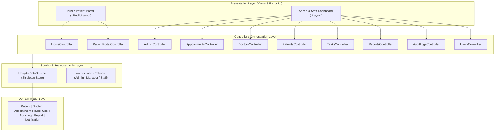

# 🏥 Hospital Management System (HMS)

> **System Analysis & Design (SAD) Course Project**  
> An enterprise-grade, web-based healthcare operational management system built with **ASP.NET Core MVC (.NET 10 / .NET 8)**.

---

## 📌 Executive Summary
The **Hospital Management System (HMS)** is designed to streamline clinical and administrative workflows across hospital departments. The system provides an integrated platform bridging patient-facing healthcare services (appointment scheduling, registration, triage tracking) with internal administrative governance (doctor scheduling, role-based authorization, task delegation, comprehensive audit trails, and analytical reporting).

---

## 🏗️ System Analysis & Requirements

### 1. Stakeholders & System Actors
- **Public / Patients:** Book appointments online 24/7 with immediate confirmation and track scheduling status.
- **System Administrator:** Full system configuration, user role management, system security parameters, and unrestricted administrative operations.
- **Hospital Manager:** Department supervision, staff task allocation, analytical reporting, and doctor schedule oversight.
- **Clinical Staff / Receptionist:** Patient check-in/intake, appointment scheduling and status updates, daily task execution.
- **Doctors / Medical Specialists:** Clinical consultation rosters, appointment reviews, and patient assignments.

### 2. Functional Requirements
- **FR-01: Public Patient Portal & Online Booking:** Self-service appointment scheduling with real-time doctor availability and confirmation.
- **FR-02: Patient Information Management:** Comprehensive CRUD operations for patient demographics, contact details, and records.
- **FR-03: Doctor & Specialty Directory:** Management of medical departments and specialized doctors (Cardiology, Pediatrics, Neurology, Surgery, etc.).
- **FR-04: Appointment Workflow Management:** Status transitions (`Pending`, `Approved`, `Completed`, `Cancelled`) with doctor allocation.
- **FR-05: Operational Task Delegation:** Priority-based task tracking (`Pending`, `InProgress`, `Completed`) with urgency matrix.
- **FR-06: Security & Role-Based Access Control (RBAC):** Cookie-backed authentication with multi-level policy enforcement (`AdministratorOnly`, `ManagerOrAdmin`, `StaffOrAbove`).
- **FR-07: Real-Time Notifications & Alerts:** Action triggers for pending appointment requests, urgent tasks, and operational updates.
- **FR-08: System Auditing & Compliance:** Automated audit logging tracking every state-altering transaction (Action, User, Timestamp, Entity details).
- **FR-09: Executive Reporting & Analytics:** Visualized KPI reporting on patient throughput, appointment distributions, and department workloads.

### 3. Non-Functional Requirements
- **Security & Integrity:** Cookie-based authentication, role-based route protection, and immutable audit logs.
- **Performance & Responsiveness:** Low-latency UI rendering via ASP.NET Core Razor views, responsive Bootstrap interface.
- **Maintainability:** Strict separation of concerns following the Model-View-Controller (MVC) architectural pattern.
- **Usability:** Clear navigation hierarchy with dedicated public and staff layouts.

---

## 📐 System Architecture & Design

### Architectural Pattern: Model-View-Controller (MVC)


### Role-Based Access Control (RBAC) Matrix
| Module / Capability | Public | Staff | Manager | Administrator |
|---|:---:|:---:|:---:|:---:|
| Browse Doctors & Hospital Info | ✅ | ✅ | ✅ | ✅ |
| Online Appointment Booking | ✅ | ✅ | ✅ | ✅ |
| Patient Records Management | ❌ | ✅ | ✅ | ✅ |
| Appointment Approval & Rescheduling | ❌ | ✅ | ✅ | ✅ |
| Operational Task Tracking | ❌ | ✅ | ✅ | ✅ |
| Doctor Directory Management | ❌ | ❌ | ✅ | ✅ |
| Executive Reporting & Analytics | ❌ | ❌ | ✅ | ✅ |
| Audit Trail Inspection | ❌ | ❌ | ❌ | ✅ |
| User & System Credentials Management | ❌ | ❌ | ❌ | ✅ |

---

## 🛠️ Technology Stack
- **Framework:** ASP.NET Core MVC (.NET 10.0 / .NET 8.0)
- **Language:** C#
- **Frontend / UI:** Razor Pages, Bootstrap 5, Custom CSS
- **Authentication:** ASP.NET Core Cookie Authentication
- **Data Architecture:** In-Memory Repository Service (`HospitalDataService`)
- **Version Control:** Git & GitHub

---

## 🚀 Getting Started

### Prerequisites
- [.NET SDK 8.0 or .NET SDK 10.0](https://dotnet.microsoft.com/download)

### Installation & Run Instructions
1. **Clone the repository:**
   ```bash
   git clone https://github.com/mahbub203/Hospital-Management-System.git
   cd Hospital-Management-System
   ```

2. **Restore dependencies and build:**
   ```bash
   dotnet restore
   dotnet build
   ```

3. **Launch the application:**
   ```bash
   dotnet run
   ```

4. **Access the application in your browser:**
   - **Public Portal:** `https://localhost:5001` or `http://localhost:5000`
   - **Staff / Admin Login:** `https://localhost:5001/Admin/Login`

### 🔑 Default Credentials (Demo Data)
| Role | Username | Password | Access Level |
|---|---|---|---|
| **Administrator** | `admin` | `admin123` | Full administrative control & audit logs |
| **Manager** | `manager` | `manager123` | Management, doctor directory & reporting |
| **Staff** | `staff` | `staff123` | Appointments, patients & task execution |

---

## 📂 Project Directory Structure
```
Hospital-Management-System/
├── Controllers/                 # MVC Controllers handling routing & business flow
│   ├── AdminController.cs
│   ├── AppointmentsController.cs
│   ├── AuditLogsController.cs
│   ├── DoctorsController.cs
│   ├── HomeController.cs
│   ├── NotificationsController.cs
│   ├── PatientPortalController.cs
│   ├── PatientsController.cs
│   ├── ReportsController.cs
│   ├── TasksController.cs
│   └── UsersController.cs
├── Models/                      # Domain entities & ViewModels
│   ├── Appointment.cs
│   ├── AuditLog.cs
│   ├── DashboardViewModel.cs
│   ├── Doctor.cs
│   ├── Notification.cs
│   ├── Patient.cs
│   ├── Report.cs
│   ├── Task.cs
│   └── User.cs
├── Services/                    # Data service & in-memory business logic
│   └── HospitalDataService.cs
├── Views/                       # Razor Views & Layouts
│   ├── Admin/
│   ├── Appointments/
│   ├── AuditLogs/
│   ├── Doctors/
│   ├── PatientPortal/
│   ├── Patients/
│   ├── Reports/
│   ├── Tasks/
│   ├── Users/
│   └── Shared/
├── wwwroot/                     # Static assets (CSS, JS, Icons)
├── HospitalManagementSystem.csproj
├── Program.cs                   # Application pipeline & dependency injection
└── README.md                    # Project documentation
```

---

## 📜 Academic Attribution
- **Course:** System Analysis and Design
- **Developed by:** Mahbubur Rahman ([@mahbub203](https://github.com/mahbub203))
